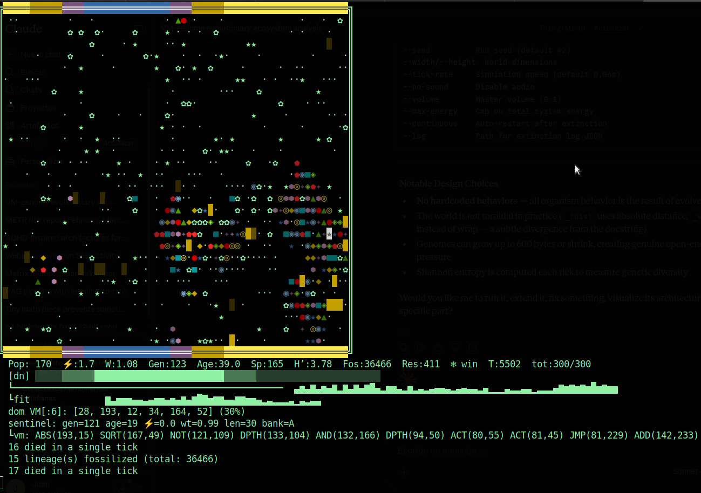

# syntropy — self-evolving ecosystem in your terminal

Digital organisms run RISC-V RV32I programs on a shared 2D grid.
No fitness function. No selection pressure. No objective. Evolution emerges bottom-up.



## Run

```bash
python3 syntropy.py
```

Ctrl+C to stop. Extinction summary on exit.

### Options

| Flag | Default | Description |
|------|---------|-------------|
| `--seed N` | 42 | Random seed |
| `--width N` | 72 | Grid width (16–256) |
| `--height N` | 26 | Grid height (8–64) |
| `--tick-rate N` | 0.06 | Seconds per tick (min 0.01) |
| `--volume N` | 0.3 | Sound volume 0–1 |
| `--no-sound` | — | Disable audio |
| `--no-environmental-sounds` | — | Disable ambient audio only |
| `--initial-population N` | 1 | Starting organisms |
| `--day-length N` | 120 | Ticks per day/night cycle |
| `--max-energy N` | 200 | System-wide energy cap |
| `--max-movement-speed N` | 0 | Max moves/tick/org (0=unlimited) |
| `--max-age N` | per-organism | Max age in ticks (0=unlimited) |
| `--mutation-rate N` | 0.06 | Per-word mutation probability at reproduction |
| `--vm-memory N` | 16 | Persistent local memory slots per organism (1–256) |
| `--n-registers N` | 32 | Usable VM registers (1–32; higher indices alias modulo N) |
| `--no-register-scan` | — | Actions only from explicit `ACT` ECALLs / action-buffer stores |
| `--shared-memory` | — | Enable shared world memory + symbol channel (GLOAD/GSTORE/SYMEMIT) |
| `--shared-mem-size N` | 64 | Shared memory slots |
| `--continuous` | — | Auto-restart on extinction |
| `--log FILE` | extinction.json | Extinction log path |

## Architecture

### Genome VM — RISC-V RV32I

A genome is a list of 32-bit RV32I instruction words (mutated by bit flips, insertion
and deletion; recombined by one-point crossover). Each tick an organism's program runs
from `pc=0` with a gas limit of `clamp(budget×50, 10, 200)` instructions, where
`budget = min(energy×0.4, 8)`. Instructions implemented: LUI, AUIPC, JAL, JALR,
BEQ/BNE/BLT/BGE/BLTU/BGEU, LB/LH/LW/LBU/LHU, SB/SH/SW, all OP-IMM and OP
(register) ALU ops, and ECALL. There is no M extension; unknown encodings are NOPs.
`x0` is hard-wired to zero. With `--n-registers N` < 32, register indices alias
modulo N.

**Memory map** (4 KiB, rebuilt each tick):

| Range | Purpose |
|-------|---------|
| `0x000–0x3FF` | Local memory (`--vm-memory` int32 slots). Persisted on the organism between ticks and inherited by offspring |
| `0x400–0x4FF` | Sensor inputs, int32, value × 1000 (read-only to the host) |
| `0x500–0x53F` | Action buffer: 16 words, `act_id | arg<<8` |
| `0x544` / `0x548` | Remaining budget (×100) / current tick |

Shared world memory is only reachable through the GLOAD/GSTORE ECALLs (not memory-mapped).

**ECALL ABI** — syscall number in `a7` (x17), arguments in `a0`/`a1`, result in `a0`:

| a7 | Call | Effect |
|----|------|--------|
| 0 | SENSE | `a0 = sensor[a0 % 28] × 1000` (NaN→0, saturating) |
| 1 | ACT | queue action `a0 % 9` with arg `a1 & 0xFF` |
| 2 | ENERGY | `a0` = remaining budget × 1000 |
| 3 | HALT | stop this tick |
| 4 | RAND | `a0 = rand(0..10000)` |
| 5 | TICK | `a0` = tick number |
| 6 / 7 | MLOAD / MSTORE | local slot `a0 % vm_memory`; store writes `a1` |
| 8 / 9 | GLOAD / GSTORE | shared byte slot `a0 % size` (needs `--shared-memory`); store clamps `a1` to 0–255 |

**Action decoding.** After the program runs, actions are collected from (1) the 16-word
action buffer (every non-zero word, including raw `SW` stores) and (2) unless
`--no-register-scan` is given, every non-zero register (`act = r & 0xF`, `arg = r>>4 & 0xF`;
at most 8). Duplicates are merged. The register scan is a bootstrap aid; it makes
behaviour partly depend on incidental register contents, so use `--no-register-scan` to
select purely on explicit `ACT` logic.

**Fault isolation.** If an organism's program ever raises, it simply takes no actions that
tick and `VM faults` is reported in the end-of-run summary; the world keeps running.

### Sensors (28)

Food position/distance/direction, nearest-organism position/distance/direction,
temperature, daylight, moisture, energy, age, population density, pressure, season,
latitude, fat, health, recent EAT/ATTACK counts, trace strength and direction, signal,
symbol id/value, facing.

### Actions (9)

MOVE (dir = arg % 4), ATTACK, EAT, REPRODUCE, REST, SOUND, EMIT, SYMEMIT, HGT.

### Weight system

All organisms start at `weight=1.0`. Movement cost = `0.02 × speed × weight × dissipation`
(speed = number of moves this tick, creating inertia). Each move burns `0.01 × speed` weight.
Eating food adds weight; eating other organisms transfers their mass (requires heavier attacker).
Weight = 0 → wasting death.

### Dual-bank DNA

Two genome banks per organism: `genome_a` (default) and `genome_b` (silent backup).
The active bank is chosen at birth and each bank mutates independently on reproduction.

### Traces & signals

Organisms deposit pheromone traces (decaying ×0.95, sensed within radius 3). EMIT
broadcasts a register value to nearby cells (read via the SIGNAL sensor). With
`--shared-memory`, SYMEMIT broadcasts a typed `(symbol_id, value)` pair read via
SYMBOL_ID / SYMBOL_VAL.

### Memory systems

**Per-organism local memory** (`--vm-memory` int32 slots, MLOAD/MSTORE): persists across
ticks for the organism's lifetime.

**Cultural transmission**: on reproduction the parent's local memory is copied to the
child with small Gaussian noise, a non-genetic inheritance channel.

**World shared memory** (`--shared-memory`, GLOAD/GSTORE): a global byte blackboard
(`--shared-mem-size` slots, values clamped to 0–255) that decays by 1 per tick.

### Per-organism audio

3-band sound (bass/mid/treble) driven by SENSE→ACT SOUND. Environmental ambient audio
(pressure→bass, moisture→bass, temperature→mid, daylight→treble, season→sub-bass).
Async mixer with persistent `aplay` process and sample-accurate phase tracking.

### Economy

- INITIAL_RESOURCES=60, RESOURCE_REGEN=3, REPRODUCTION_THRESHOLD=6.0
- Summer upkeep 0.06/tick, winter 0.12/tick
- System-wide energy cap (default 200): total organism energy+fat scaled proportionally when exceeded
- Energy dissipation above 5.0: `1.0 + max(0, energy-5.0) × 0.15` — anti-hoarding pressure
- Program length is bounded by the per-tick gas limit (see VM above)

### Ecology

- Non-toroidal world (edges clamp) — edge ecology
- Day/night cycle with horizontal bar visualization
- Seasons (summer/winter) affect temperature and upkeep
- Temperature gradient: latitude + season ± diurnal cosine
- Disease, immunity, territory, nests, fossils
- Horizontal gene transfer, spontaneous mutation, fighting overlap
- Weak auto-eat (30%+age bonus) and auto-reproduce (10% at 2× threshold) for bootstrap

## Visualization

| Glyph | Meaning |
|-------|---------|
| `·` | Food resource |
| `⬟` | Organism (varies by hue/energy) |
| `▲●★◆◉■⬢✦✧◈` | Species glyphs |
| `✿` | Corpse / special resource |
| `═══` | Top/bottom bars with day/night coloring |

Status line: Pop, avg energy, avg weight, generation, avg age, species count,
Shannon diversity, fossils, resources, season, tick, total system energy.

## Tools

- `search.py` — hyperparameter sweep (`--max-energy`, `--max-movement-speed`,
  `--n-registers`); `--output FILE` saves results including each best genome as
  `best_genome` (list of RV32 words).
- `disasm.py FILE` — disassemble the genomes saved by `search.py --output`.

## Tests

```bash
pip install pytest
python3 -m pytest tests
```

## Requirements

Python 3.10+. No runtime dependencies (pytest for tests only).
